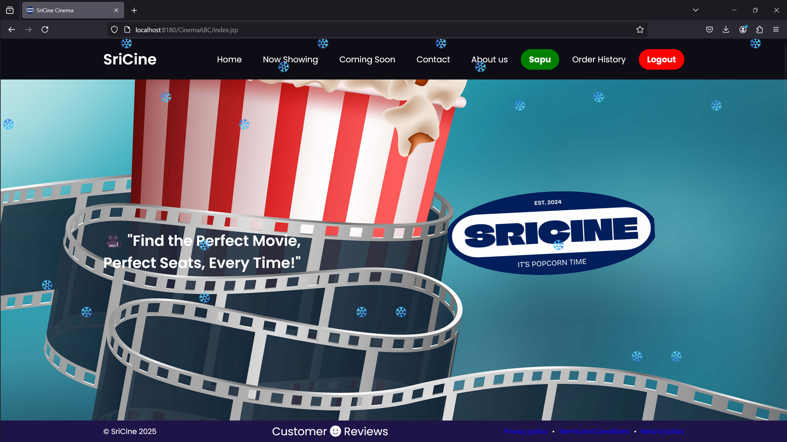
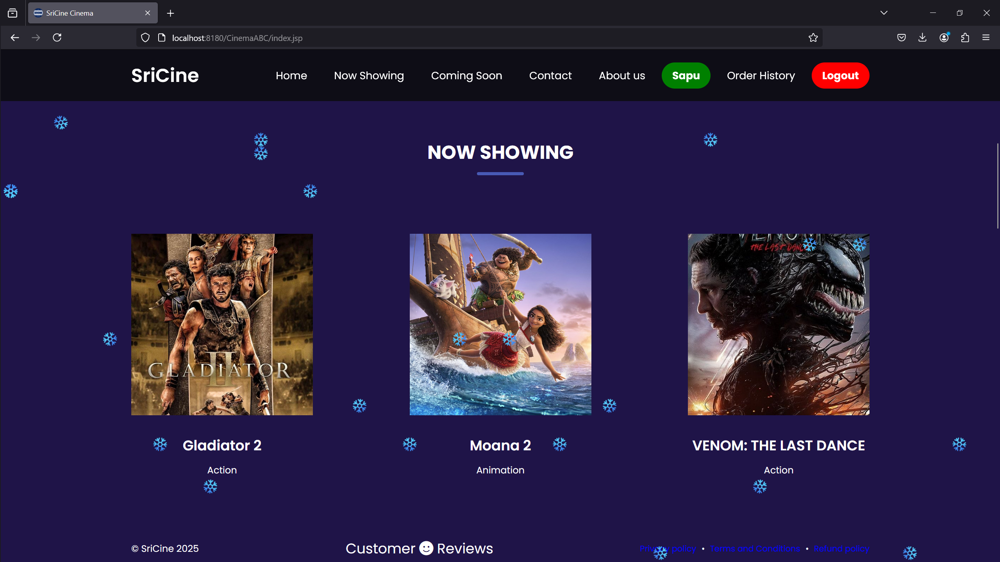
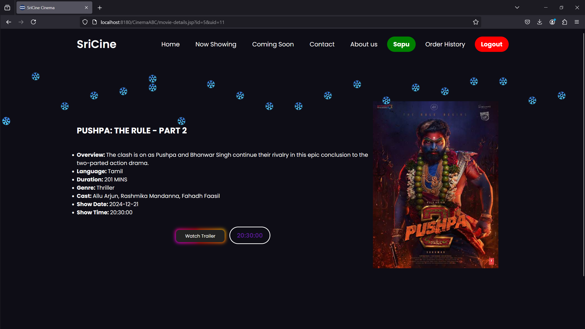
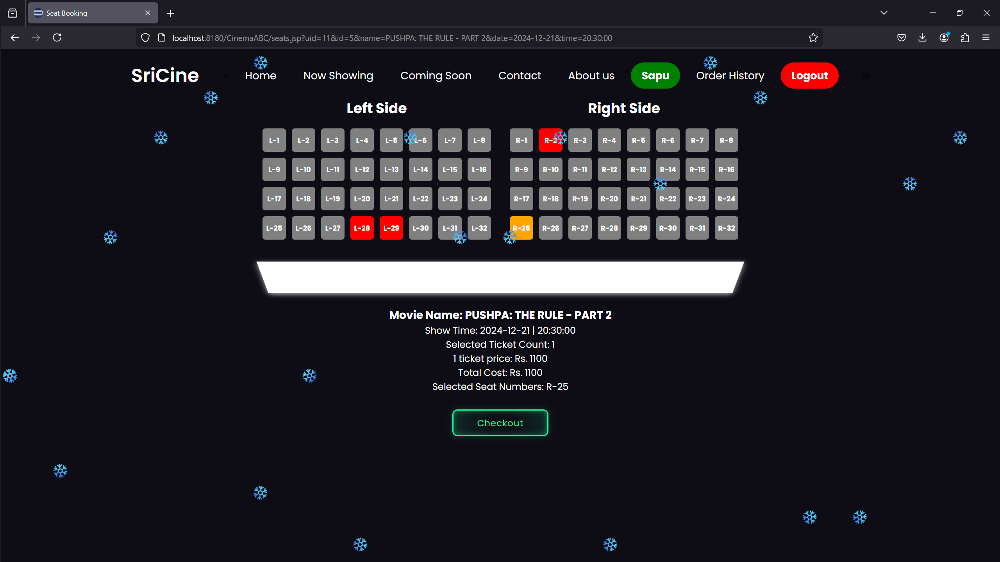
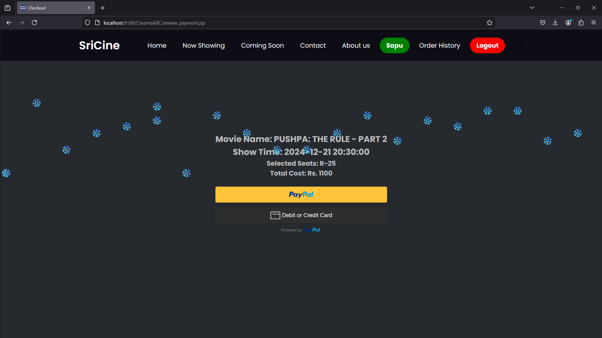
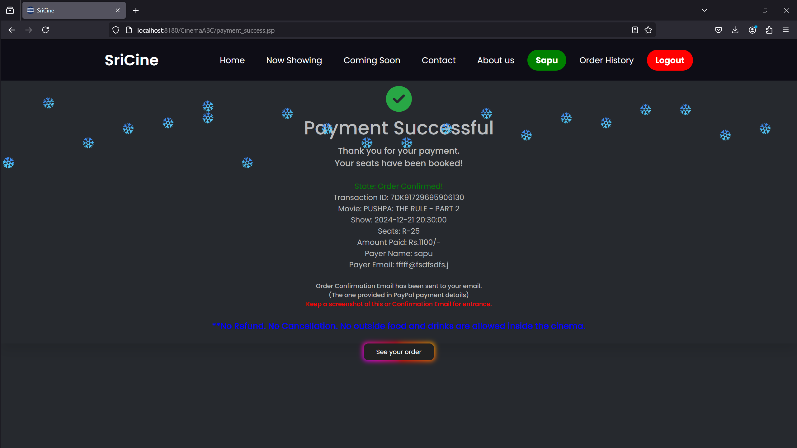
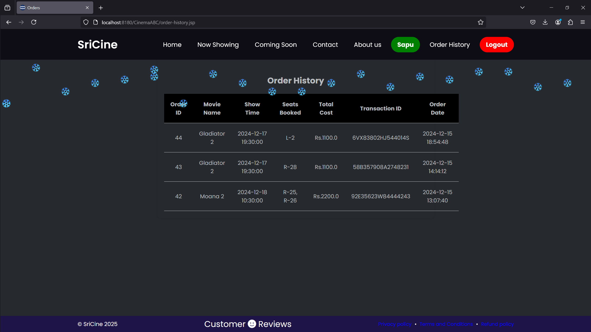
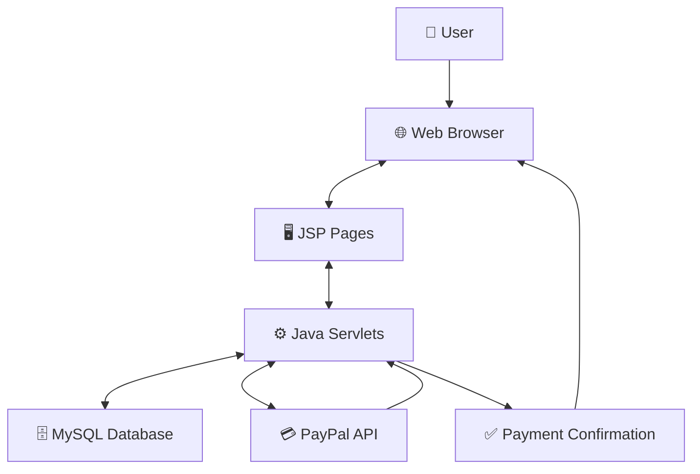

<div align="center">

# 🎬 SriCine
### Cinema Ticket Booking System

**Your Movie. Your Seat. Your Experience.**

A Java-based web application for browsing movies, selecting cinema seats, and completing the ticket booking checkout workflow with PayPal API integration.

<br>


</div>

---

## 📖 Table of Contents

- [🎬 About the Project](#-about-the-project)
- [💡 Why SriCine?](#-why-sricine)
- [✨ Features](#-features)
- [🖼️ Application Screenshots](#️-application-screenshots)
- [🛠️ Technology Stack](#️-technology-stack)
- [🏗️ Application Architecture](#️-application-architecture)
- [📂 Project Structure](#-project-structure)
- [⚙️ Getting Started](#️-getting-started)
- [🗄️ Database Configuration](#️-database-configuration)
- [▶️ Running the Application](#️-running-the-application)
- [🔐 Security Considerations](#-security-considerations)
- [🚀 Future Improvements](#-future-improvements)
- [🤝 Contributing](#-contributing)
- [👨‍💻 Author](#-author)

---

## 🎬 About the Project

**SriCine** is a cinema ticket booking web application developed using Java, JavaServer Pages (JSP), Servlets, and MySQL, with PayPal API integration in the checkout workflow.

The project brings together movie discovery, movie details, seat selection, checkout, payment confirmation, and booking history in a single web application.

By combining Java-based server-side development with relational database management and an external payment service, SriCine explores how a traditional web application can support an end-to-end cinema ticket booking experience.

### 🎯 Project Overview

| Category | Details |
|---|---|
| Project Name | SriCine Cinema Ticket Booking System |
| Application Type | Web Application |
| Backend Language | Java |
| Web Technologies | JSP and Servlets |
| Database | MySQL |
| Payment Integration | PayPal API |
| Build Tool | Apache Ant |
| Project Configuration | NetBeans-style project configuration |

---

## 💡 Why SriCine?

Cinema ticket booking involves several connected steps, from discovering a movie to selecting seats and completing payment.

SriCine explores how these steps can be brought together in a web-based platform, providing users with a more convenient way to navigate the booking process.

The project also demonstrates practical software engineering concepts, including:

- **Backend Development:** Implementing server-side application logic using Java.
- **Dynamic Web Development:** Using JSP and Servlets to support interactive web functionality.
- **Database Integration:** Using MySQL to manage structured application data.
- **Third-Party API Integration:** Connecting the checkout workflow with PayPal.
- **Application Workflow Design:** Organizing the stages of a cinema ticket booking experience.
- **Build Automation:** Managing the project build using Apache Ant.

---

## ✨ Features

### 🔐 User Access
- Dedicated login interface.

### 🎞️ Movie Discovery
- Home page for navigating the application.
- Movie browsing interface.
- Individual movie details pages.

### 💺 Ticket Booking
- Cinema seat selection interface.
- Checkout page for the booking process.
- Booking history interface.

### 💳 Online Payment
- **PayPal API integration** in the checkout workflow.
- Payment completion screen.

The features above reflect the interfaces and functionality identified for the project. Specific authentication rules, payment processing behavior, and booking validation depend on the implementation.

---

## 🖼️ Application Screenshots

Explore the SriCine interface and its cinema ticket booking workflow.

### 🔐 Login

<div align="center">

</div>

### 🏠 Home Page

<div align="center">

</div>

### 🎞️ Movie Browsing

<div align="center">

</div>

### 🎬 Movie Details

<div align="center">

</div>

### 💺 Seat Selection

<div align="center">

</div>

### 🛒 Checkout

<div align="center">

</div>

### ✅ Payment Confirmation

<div align="center">

</div>

### 📋 Booking History

<div align="center">

</div>

---

## 🛠️ Technology Stack

| Technology | Purpose |
|---|---|
| ☕ Java | Backend programming and application logic |
| 🌐 JavaServer Pages (JSP) | Server-side web page rendering |
| ⚙️ Java Servlets | HTTP request handling and server-side processing |
| 🗄️ MySQL | Relational database management |
| 💳 PayPal API | Payment integration within the checkout workflow |
| 🔨 Apache Ant | Build automation |
| 🧰 NetBeans | Project development and configuration support |

---

## 🏗️ Application Architecture

SriCine combines a Java web application, a relational database, and an external payment service.



### How It Works

1. **User Interaction:** Users access the application through a web browser.
2. **Web Interface:** JSP pages provide the web interface for the booking workflow.
3. **Request Processing:** Java Servlets handle web requests and coordinate server-side operations.
4. **Database Operations:** MySQL stores and retrieves application data.
5. **Payment Integration:** The checkout workflow integrates with PayPal for payment processing.
6. **Payment Feedback:** The application provides a payment completion screen.

*The diagram illustrates the application's high-level components. The exact request flow and payment handling depend on the implemented code.*

---

## 📂 Project Structure

```text
Cinema-Ticket-Booking-System/
│
├── nbproject/
│   └── IDE project configuration
│
├── src/
│   └── Java application source files
│
├── web/
│   ├── images/
│   │   └── ss/
│   │       ├── login.png
│   │       ├── HomePage.png
│   │       ├── movies.png
│   │       ├── movie-details.png
│   │       ├── seats.png
│   │       ├── checkout.png
│   │       ├── payment-done.png
│   │       └── history.png
│   │
│   └── Other web application resources
│
├── build.xml
│
└── README.md
```

### Key Files and Directories

| Path | Description |
|---|---|
| `src/` | Java application source code. |
| `web/` | Web pages, images, and other application resources. |
| `web/images/ss/` | Screenshots documenting the application interface. |
| `nbproject/` | Project configuration associated with NetBeans. |
| `build.xml` | Apache Ant build configuration. |
| `README.md` | Project documentation. |

---

## ⚙️ Getting Started

Follow these steps to prepare your local development environment.

### Prerequisites

Install the following:

- Java Development Kit (JDK) compatible with the project.
- Apache Ant or an IDE with Ant project support.
- MySQL Server.
- A compatible Java web application server.
- Git.

### 1. Clone the Repository

```bash
git clone https://github.com/sapuCodes/Cinema-Ticket-Booking-System.git
```

Navigate into the project directory:

```bash
cd Cinema-Ticket-Booking-System
```

### 2. Open the Project

Open the project in NetBeans or another compatible Java web development environment.

Allow the IDE to load the existing project configuration.

### 3. Configure MySQL

Start your MySQL server and identify the database configuration expected by the application.

Check the source code and repository files for:

- Database name and schema.
- Required tables.
- JDBC connection URL.
- Database username and password.
- SQL setup or initialization scripts.

Configure the database connection to match your local environment.

### 4. Configure PayPal

Review the existing PayPal integration and identify its required configuration.

Depending on the implementation, this may include:

- PayPal application credentials.
- API configuration.
- Sandbox or live environment settings.
- Checkout and payment response handling.

Use the configuration format expected by the source code.

**Important:** Never commit PayPal secrets, access tokens, or database passwords to a public repository.

### 5. Build the Project

From the project directory, run:

```bash
ant
```

Alternatively, use the build command provided by your IDE.

If the build fails, review the output for missing dependencies, incompatible Java versions, or project configuration issues.

### 6. Deploy and Run

1. Start MySQL.
2. Verify the database configuration.
3. Confirm that PayPal is configured for the intended environment.
4. Build the application.
5. Deploy it to a compatible Java web application server.
6. Start the application server.
7. Open the deployed application in your browser.

The exact deployment commands and application URL depend on the project configuration.

---

## 🗄️ Database Configuration

MySQL provides relational database storage for the application.

Before running SriCine, verify that:

- MySQL Server is running.
- The required database has been created.
- The required tables exist.
- JDBC connectivity is configured correctly.
- The database credentials are valid.
- The database user has the required permissions.

Refer to the actual project source and SQL scripts for the correct database setup procedure.

---

## 💳 PayPal Integration

SriCine integrates the PayPal API into its checkout workflow.

This integration is an important part of the project because it connects a Java web application with an external payment service.

The payment workflow should be configured according to the PayPal integration implemented in the source code.

### Important Considerations

- Use the PayPal Sandbox for development and testing when supported by the integration.
- Keep API credentials outside public source code.
- Validate payment results on the server rather than relying solely on browser redirects.
- Handle unsuccessful, cancelled, and pending payments appropriately.
- Ensure that booking confirmation reflects the actual payment status.
- Avoid processing the same payment more than once.

These are recommended payment integration practices, not claims that every safeguard is already implemented.

For official documentation, visit the [PayPal Developer Portal](https://developer.paypal.com/).

---

## 🔐 Security Considerations

When developing or deploying a cinema booking application, consider the following:

- Store credentials securely.
- Validate and sanitize user input.
- Use parameterized SQL queries to help prevent SQL injection.
- Protect authenticated routes and user-specific booking information.
- Verify payment status on the server.
- Use HTTPS in production.
- Avoid exposing sensitive payment or database information in logs.

These practices can help strengthen the application as it develops.

---

## 🧪 Troubleshooting

### Build Errors

Check that the installed JDK is compatible with the project and that required dependencies are available.

Review the Apache Ant output for compilation errors.

### Database Connection Errors

Verify the MySQL service, database URL, credentials, JDBC driver, and required tables.

### PayPal Errors

Check the API credentials, environment configuration, request parameters, and PayPal response handling.

Ensure that Sandbox credentials are not accidentally used for a live environment or vice versa.

### Deployment Errors

Review the application server logs for missing libraries, unsupported APIs, or configuration problems.

---

## 🚀 Future Improvements

Potential enhancements include:

- Responsive design for mobile devices.
- Improved movie search and filtering.
- More detailed movie and showtime information.
- Enhanced seat availability management.
- Stronger booking validation.
- Improved handling of unsuccessful or cancelled payments.
- Automated unit and integration tests.
- Improved error handling and application logging.
- More comprehensive deployment documentation.

These are possible future enhancements rather than claims about existing functionality.

---

## 🤝 Contributing

Contributions and suggestions are welcome.

To contribute:

1. Fork the repository.
2. Create a branch for your changes.
3. Implement and test your improvements.
4. Commit your changes with a descriptive message.
5. Push your branch to your fork.
6. Open a pull request describing your contribution.

---

## 👨‍💻 Author

**Sapumal Prasanna**

Software Engineering Undergraduate

- **GitHub:** [@sapuCodes](https://github.com/sapuCodes)
- **LinkedIn:** [Sapumal Prasanna](https://www.linkedin.com/in/sapumalprasanna/)

---

<div align="center">

### 🎬 Thanks for Exploring SriCine!

If you find this project interesting, consider giving the repository a ⭐.

**Built with Java, JSP, Servlets, MySQL, and PayPal API integration.**

</div>
